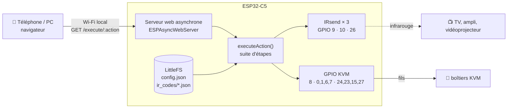

<div align="center">

# 📟 Télécommande unifiée ESP32-C5

**Une seule page web pour piloter tous tes appareils : télé, ampli, écrans, commutateurs KVM.**


</div>

---

## ✨ Le principe

Une carte **ESP32-C5** se connecte à ton Wi-Fi et sert un petit **site web local**. Depuis ton téléphone ou ton PC, un bouton peut déclencher une **suite d'actions** :

- 📺 **Infrarouge** : envoyer les codes d'une télécommande (allumer la télé, monter le son…) sur **3 émetteurs IR** indépendants ;
- 🔀 **Commutateurs KVM** : basculer l'écran, le clavier et la souris d'un PC à l'autre en pilotant directement les broches des boîtiers KVM (jusqu'à 3 boîtiers) ;
- ➕ **Apprentissage** : ajouter de nouveaux codes IR depuis la page web, enregistrés sur la carte.

Exemple d'action « Mode jeu » : allumer la télé, passer sur l'entrée HDMI 2, basculer le KVM sur le PC de jeu — en un seul clic.

---

## ⚙️ Comment ça marche



| Route | Rôle |
|---|---|
| `GET /` | page de contrôle |
| `GET /execute/:action` | exécute une action décrite dans `config.json` (étapes IR et KVM) |
| `POST /ir/add` | enregistre un nouveau code IR |
| `GET /static/:fichier` | fichiers de la page (CSS, JS) |

---

## 🚀 Installation

1. **Arduino IDE** (ou PlatformIO) avec le support des cartes **ESP32** (Espressif, version 3.x pour l'ESP32-C5).
2. Bibliothèques : `ESPAsyncWebServer`, `AsyncTCP`, `ArduinoJson`, `IRremoteESP8266`.
3. Ouvre `firmware/Telecommande_ESP32_C5/Telecommande_ESP32_C5.ino` et renseigne ton réseau :
   ```cpp
   const char* ssid = "VOTRE_SSID";
   const char* password = "VOTRE_MOT_DE_PASSE";
   ```
   ⚠️ Ne publie jamais le fichier avec tes vrais identifiants Wi-Fi.
4. Téléverse le programme, puis les fichiers `config.json` et `ir_codes/` dans la mémoire LittleFS de la carte.
5. Le moniteur série (115 200 bauds) affiche l'adresse IP : ouvre-la dans un navigateur.

---

## 🗂️ Organisation des fichiers

```
Telecommande-unifie-ESP32-C5/
├── firmware/
│   ├── Telecommande_ESP32_C5/
│   │   └── Telecommande_ESP32_C5.ino   programme principal : Wi-Fi, serveur web, IR, KVM
│   └── IR_code_exemple.json            exemple de codes IR bruts (durées en µs)
├── exemples-fabricant/
│   └── esp32-c5_wifi-001/              démo du fabricant : point d'accès Wi-Fi + LED WS2812
└── docs/
    ├── carte/
    │   ├── schema.pdf                  schéma électronique de la carte
    │   ├── pcb-v1.2.pdf                circuit imprimé (CH340, v1.2)
    │   ├── brochage.jpg                définition des broches
    │   ├── composants.jpg              description des composants
    │   └── dimensions.jpg              dimensions de la carte
    ├── certifications/                 CE-RED, RoHS, FCC, SRRC du module
    └── esp32-c5-datasheet.pdf          fiche technique Espressif
```

---

## 💻 Compatibilité

| | |
|---|---|
| **Carte** | ESP32-C5 (Wi-Fi 6 bi-bande 2,4 / 5 GHz), port USB CH340 |
| **Émetteurs IR** | LED infrarouges 940 nm sur GPIO 9, 10 et 26 (avec transistor) |
| **KVM** | boîtiers à boutons pilotables par GPIO (niveau 3,3 V) |
| **Outils** | Arduino IDE 2.x ou PlatformIO |

---

## 🧭 En cours de développement

- [ ] **Lecture des fichiers LittleFS** : la boucle de chargement des codes IR utilise encore l'API `Dir` de l'ESP8266 ; à porter sur l'API ESP32 (`File::openNextFile()`).
- [ ] Page web de contrôle (dossier `data/`) et exemple de `config.json`.
- [ ] Récepteur IR pour apprendre les codes directement depuis une télécommande.
- [ ] Protection de la page par mot de passe sur le réseau local.

---

## 📜 Licence

MIT — libre d'utilisation et de modification, voir [LICENSE](LICENSE). Les documents du dossier `docs/` appartiennent à leurs fabricants respectifs.

---

<div align="center"><sub>ESP32-C5 · Arduino · infrarouge · fait maison</sub></div>
